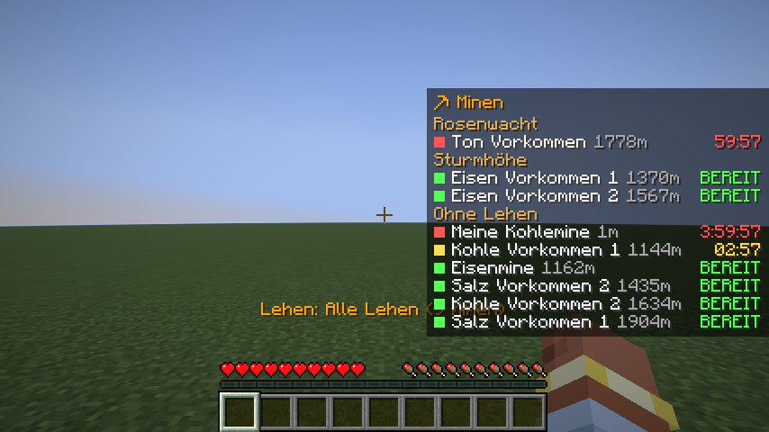

# OttonienUtils

Kleine Client-Mods für den Minecraft-Rollenspiel-Server **Ottonien**, damit der Alltag im Spiel etwas leichter wird.

> **Inoffiziell:** OttonienUtils ist ein Projekt von Spielern für Spieler. Es ist kein offizielles Projekt des Ottonien-Teams und wird von ihm nicht betreut. Die Mods sind nur für Ottonien gedacht und auf anderen Servern wenig nützlich.

## Mods

| Mod | Wofür | Version |
|---|---|---|
| [Minen-Timer](minentimer/README.md) | Respawn-Timer für Minen und Vorkommen mit Overlay, Lehen-Gruppen und Timern, die du mit deiner Gruppe teilst | siehe [Changelog](minentimer/CHANGELOG.md) |
| [Lehenskarte](lehenskarte/README.md) | Alle Lehen mit Grenzen, Farben der Machtbereiche und aktuellen Wappen in Xaero's World Map und Minimap | siehe [Changelog](lehenskarte/CHANGELOG.md) |

<a href="minentimer/README.md"></a>

Weitere Mods folgen.

## Installation

1. Installiere **Fabric** für **Minecraft 1.21.11**, zum Beispiel über die Modrinth-App, dazu die **Fabric API**.
2. Lade die gewünschte Mod unter [Releases](https://github.com/yuyukey/OttonienUtils/releases) herunter. Jede Mod hat eigene Releases, z. B. `minentimer-v1.2.2`.
3. Leg die JAR in den `mods`-Ordner deines Profils und starte das Spiel.

Wie die einzelnen Mods funktionieren, steht in ihrer eigenen Anleitung.

## Aufbau

```
OttonienUtils/
├── minentimer/        Minen-Timer (Mod, Anleitung, Changelog, Sync-Server)
├── lehenskarte/       Lehenskarte (Mod, Anleitung, Changelog)
├── gradle/            Gradle-Wrapper, gemeinsam für alle Mods
├── gradle.properties  gemeinsame Versionen (Minecraft, Fabric)
└── settings.gradle    Liste aller Mods
```

Neue Mods bekommen einen eigenen Ordner und eine Zeile `include '<ordner>'` in `settings.gradle`.

## Selbst bauen

Du brauchst ein JDK 25, damit Gradle läuft. Im Hauptordner:

```bash
./gradlew build
```

Die JARs liegen danach in `<mod>/build/libs/`.

## Fehler und Ideen

Fehler meldest du und Ideen schlägst du vor unter [Issues](https://github.com/yuyukey/OttonienUtils/issues).

## Lizenz

[MIT](LICENSE): Du darfst den Code frei nutzen, ändern und weitergeben, solange der Lizenzhinweis erhalten bleibt.
