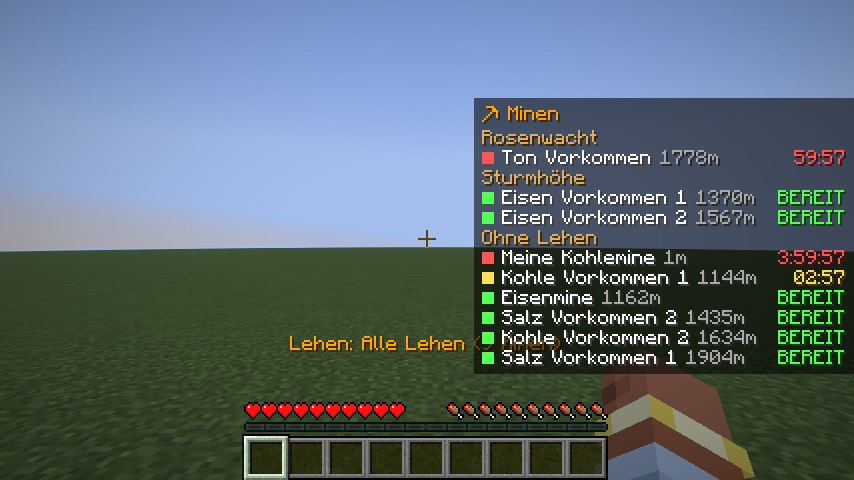
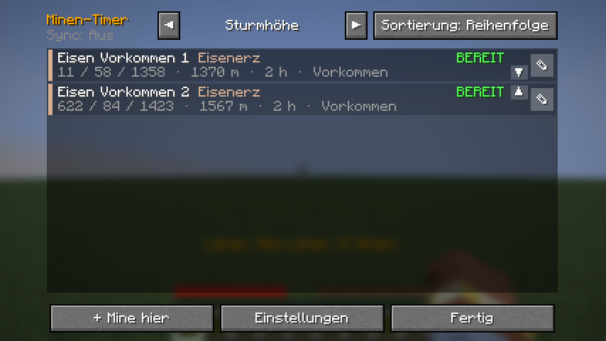
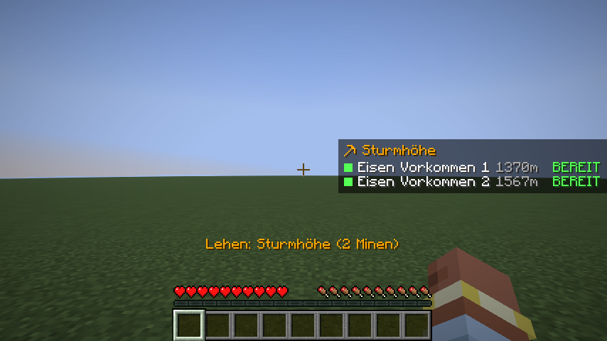
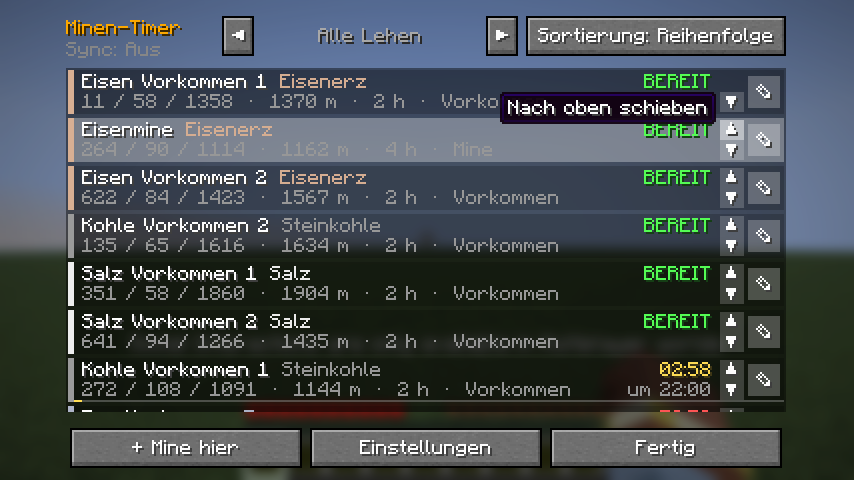
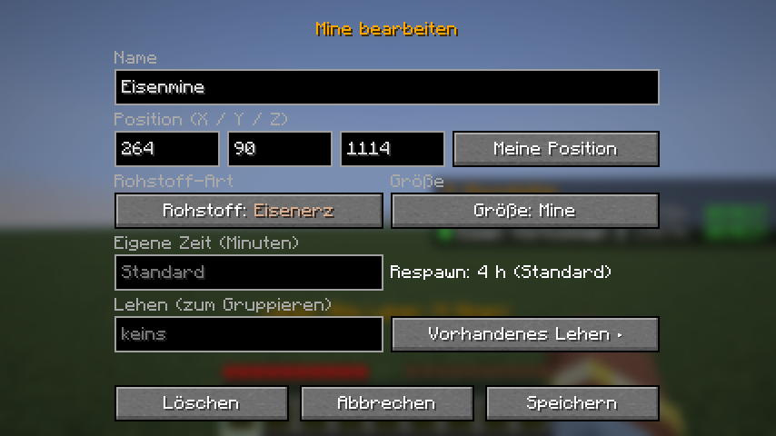
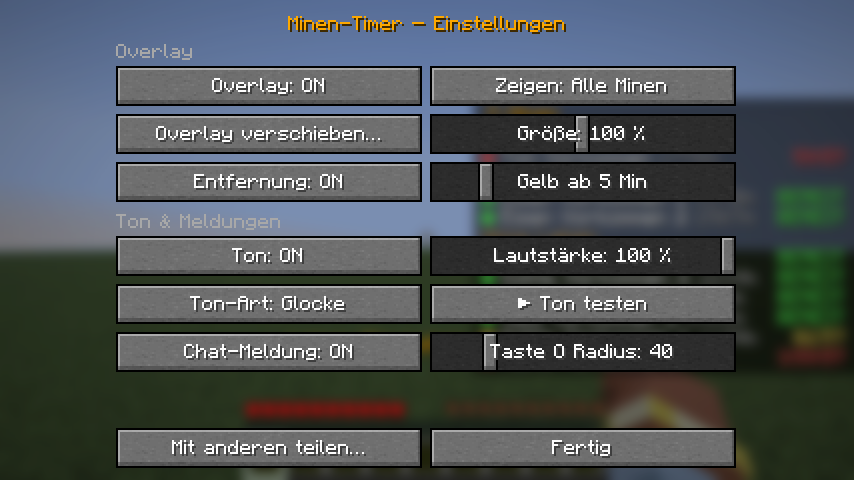
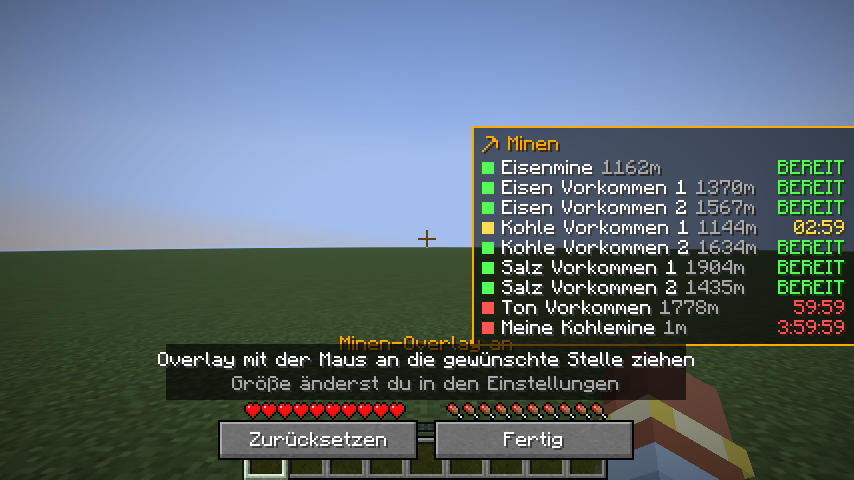

# Minen-Timer

Client-Mod für **Minecraft 1.21.11 (Fabric)**, gemacht für den Rollenspiel-Server **Ottonien**. Sie zeigt Respawn-Timer für Minen und Vorkommen, mit Overlay, Ton, Lehen-Gruppen und Timern, die du mit deiner Gruppe teilst.

> Inoffiziell: von Spielern für Spieler, kein Projekt des Ottonien-Teams. Teil von [OttonienUtils](../README.md).



## Screenshots

| | |
|---|---|
|  |  |
| **Menü (P):** Minen eines Lehens, mit ◀ / ▶ umschalten | **Overlay** für ein einzelnes Lehen, mit Hinweis beim Umschalten |
|  |  |
| **Umsortieren** mit ▲ / ▼, Timer und Restzeit pro Mine | **Mine bearbeiten:** Name, Position, Rohstoff, Größe, eigene Zeit, Lehen |
|  |  |
| **Einstellungen** für Overlay, Ton und Meldungen | **Overlay verschieben:** einfach mit der Maus ziehen |

*Die Bilder stammen aus einer Testwelt. Auf Ottonien sieht es genauso aus, nur mit echter Landschaft.*

## Installation

1. Lade die neueste `minentimer-….jar` unter [Releases](https://github.com/yuyukey/OttonienUtils/releases) herunter und lege sie in deinen `mods`-Ordner. Ältere Versionen vorher löschen (bei Modrinth: Profil → Ordner öffnen → `mods`).
2. Außerdem wird **Fabric API** für 1.21.11 benötigt (falls noch nicht installiert, über Modrinth hinzufügen).
3. Spiel starten. Die Einstellungen liegen danach in `config/minentimer/`.

## Bedienung

| Taste | Funktion |
|---|---|
| **#** | Nächste Mine (im Umkreis, Standard 40 Blöcke) markieren und ihren Timer starten |
| **Numpad 3** | Menü mit allen Minen öffnen/schließen |
| **Numpad 4** | Overlay ein/aus |
| **Pfeil rechts / links** | Nächstes / vorheriges Lehen (Liste und Overlay zeigen nur dessen Minen) |

Alle Tasten lassen sich unter **Optionen → Steuerung → Tastenbelegung → Minen-Timer** ändern.

**Im Menü (P):**
- **Linksklick** auf eine Mine → Timer starten
- **Rechtsklick** → Timer zurücksetzen (bei Fehlklick)
- **Shift + Mausrad** über einem laufenden Timer → ±5 Minuten, **Strg + Mausrad** → ±1 Minute (falls du zu spät markiert hast)
- **✎** rechts → Mine bearbeiten (Name, Koordinaten, Rohstoff-Art, Größe Vorkommen/Mine, eigene Zeit, Lehen, löschen)
- **+ Mine hier** → neue Mine an deiner aktuellen Position anlegen (Koordinaten kannst du danach noch ändern)
- **▲ / ▼** neben dem ✎ → Mine in der Liste nach oben/unten schieben (deine eigene Reihenfolge, gilt auch fürs Overlay und nur für dich)
- **Sortierung** → Reihenfolge (deine eigene) / Entfernung / Status. Das Overlay sortiert genauso, und bei „Alle Lehen“ gruppiert es die Minen zusätzlich nach Lehen. Die Sortierung gilt nur für dich.
- **◀ / ▶** oben → Lehen umschalten (Alle Lehen → jedes Lehen → Ohne Lehen)

**Lehen-Gruppen:** Trag beim Bearbeiten einer Mine im Feld **Lehen** einen Namen ein (z. B. *Sturmhöhe*). Mit „Vorhandenes Lehen ▸“ übernimmst du einen schon benutzten Namen. Alle Minen mit demselben Namen bilden eine Gruppe, die du mit den Pfeiltasten durchschaltest. Die Markier-Taste (#) findet weiterhin die nächste Mine aus allen Lehen, und Bereit-Meldungen kommen auch für alle.

## Respawn-Zeiten

| Rohstoff | Vorkommen (klein) | Mine (groß) |
|---|---|---|
| Eisenerz | 2 h | 4 h |
| Steinkohle | 2 h | 4 h |
| Salz | 2 h | 4 h |
| Torf | 4 h | 4 h |
| Ton | 1 h | 1 h |

Jede Mine bzw. jedes Vorkommen hat **einen** Timer. Die Zeit ergibt sich aus Rohstoff-Art und Größe (kleines **Vorkommen** oder große **Mine**). Wie viele Erze darin sind, spielt keine Rolle. Pro Mine kann zusätzlich eine **eigene Zeit in Minuten** eingetragen werden.

## Einstellungen

Im Menü auf **Einstellungen**: Overlay an/aus, **Zeigen** (alle Minen / nicht im Cooldown), **Overlay verschieben…** (Overlay mit der Maus an die gewünschte Stelle ziehen), Größe, Entfernung anzeigen, ab wann gelb, Ton an/aus, Ton-Art, Lautstärke, Chat-Meldung, Radius für die Markier-Taste (#).

## Mit anderen teilen

Die Mod teilt Timer **automatisch** über den eigenen Server `https://minen.vprondzinski.de`. Niemand muss etwas einstellen: JAR in den `mods`-Ordner legen, fertig. Oben im Menü steht dann „Sync: Verbunden“.

Wie der Server auf dem Ubuntu-Server eingerichtet wird, steht in [server/EINRICHTEN.md](server/EINRICHTEN.md).

Geteilt werden Timer **und** Minen (auch selbst angelegte). Bei gleichzeitigen Änderungen gewinnt die neueste. Der Abgleich passiert alle 10 Sekunden. Im Menü siehst du beim Darüberfahren, **wer** eine Mine markiert hat.

Unter **P → Einstellungen → Mit anderen teilen…** kann man das Teilen ausschalten, einen anderen **Gruppen-Code** wählen (getrennte Timer, z. B. für einen anderen Clan) oder mit **Standard-Server** alles zurücksetzen. Statt des eigenen Servers funktioniert auch eine Firebase Realtime Database, deren URL man dort einträgt.

> **Wichtig:** Dein **Gruppen-Code** ist wie ein Passwort. Wer ihn kennt, sieht und ändert die Minen und Timer eurer Gruppe. Nimm also nicht `standard`, sondern einen eigenen Code, und gib ihn nur an deine Leute.

## Datenschutz

Beim Teilen gehen an den Server: die Minen und Timer deiner Gruppe und dein **Minecraft-Name** bei Timern, die du startest („markiert von …“). Wie bei jeder Internetverbindung sieht der Server außerdem deine IP-Adresse. Sonst sendet die Mod nichts, also keine Chat-Nachrichten, keine Dateien und keine Daten über deinen PC. Wer nicht teilen will, schaltet es unter **P → Einstellungen → Mit anderen teilen…** aus.

## Selbst bauen

Im Hauptordner von OttonienUtils:

```bash
./gradlew :minentimer:build
```

Du brauchst ein JDK 25, damit Gradle und Loom laufen. Die fertige JAR liegt danach in `minentimer/build/libs/`.

Der Schlüssel für den eingebauten Server steht nicht im Repository. Wer ihn hat, legt ihn in `minentimer/sync-key.txt` ab (diese Datei wird nie hochgeladen) oder setzt die Umgebungsvariable `MINENTIMER_SYNC_KEY`. Ohne Schlüssel baut die Mod trotzdem. Zum Teilen brauchst du dann deinen eigenen Server (siehe [server/EINRICHTEN.md](server/EINRICHTEN.md)) oder eine Firebase-Datenbank.

`./gradlew :minentimer:runClientGameTest` startet einen automatischen Test im Spiel und macht dabei Screenshots. Für den Teil mit dem Teilen muss lokal `server/minentimer-server.py` auf Port 8765 laufen.
